
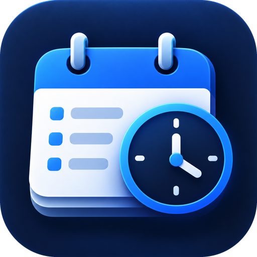

# Stundenbuch

**Deine Arbeitszeit, Stundenzettel, Urlaub und Überstunden – in einer App.**
Für Android, kostenlos, ohne Konto und ohne Werbung. Deine Daten bleiben auf deinem Handy.

### [⬇️ Stundenbuch 2.9 herunterladen](https://github.com/games-yves-mrichter-droid/stundenbuch-updates/raw/main/Stundenbuch.apk)

  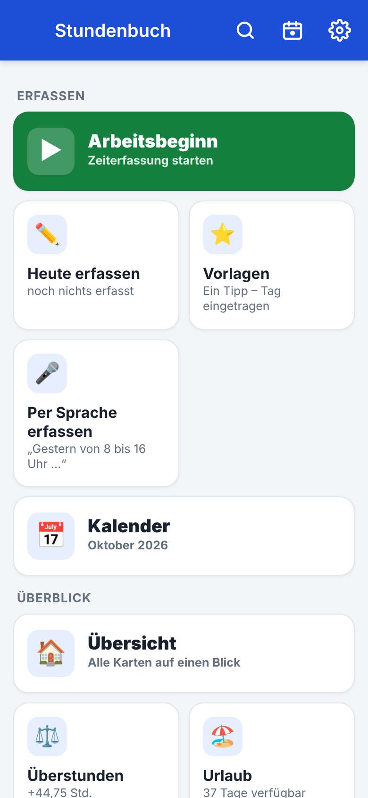
  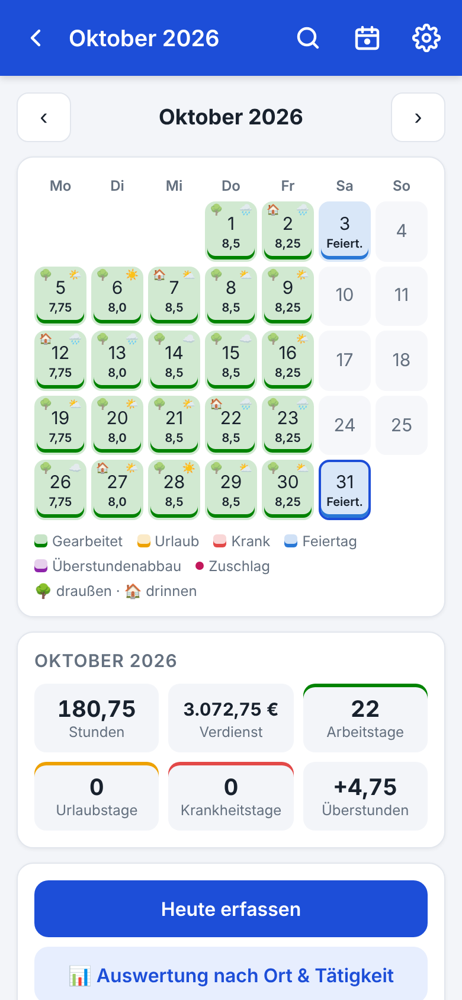
  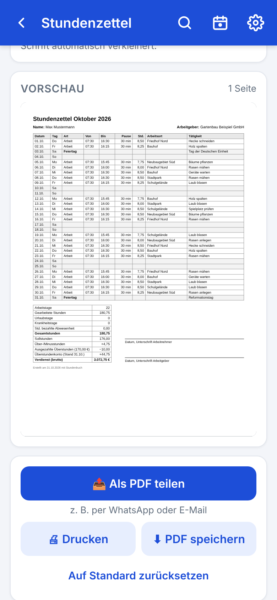

---

## Was kann die App?

### ⏱️ Arbeitszeit erfassen
- **Start/Stopp mit einem Tipp** – im Hauptmenü oder über das Widget auf dem Startbildschirm
- Tage nachtragen, mehrere Einsätze am Tag, Nachtschichten über Mitternacht
- **Vorlagen:** häufige Tage (z. B. „Stadtpark · Rasen mähen · 07:30–16:00“) mit einem Tipp eintragen
- **Per Sprache:** „Gestern von 8 bis 16 Uhr im Stadtpark Rasen gemäht“ – die App füllt alles aus
- Arbeitsort, Tätigkeit, Fotos und Auslagen mit Beleg zu jedem Tag
- Erinnerung, wenn du vergessen hast einzutragen oder die Zeiterfassung noch läuft

### 📄 Stundenzettel
- Monat als **PDF per WhatsApp oder E-Mail** verschicken, speichern oder drucken
- Spalten ein- und ausblenden – **passt automatisch auf eine A4-Seite**
- Mit Summen, Überstunden, Verdienst und Unterschriftsfeldern

### 🏖️ Urlaub, Überstunden & Lohn
- Urlaubskonto mit Übertrag und Korrektur, Feiertage aller Bundesländer
- **Brückentag-Planer:** zeigt, wo du mit wenigen Urlaubstagen lange frei hast – erst simulieren, dann eintragen
- Überstundenkonto nach Wochen- oder Monatssoll, **Arbeitszeit-Simulator** („6 Wochen täglich 1 Stunde länger?“)
- Stundenlohn mit Lohnerhöhungen, **Zuschläge** für Wochenende, Feiertag und Nacht – als Geld oder als Zeitgutschrift
- **Überstunden auszahlen lassen:** Stunden und Stundenlohn eintragen, die Summe wird ausgerechnet

### 📊 Auswertungen
- **Jahresbericht** mit Vorjahresvergleich und **Gesamtstatistik** über alle Jahre
- Stunden je Arbeitsort und Tätigkeit, Heatmap, Rekorde
- **Wettertagebuch** und Wetter-Auswertung: „Bei Regen arbeitest du im Schnitt 0,5 Std. weniger“
- **Erfolge 🏅** – passend zu deinen eigenen Arbeitsorten und Tätigkeiten
- **Überstundenkonto mit Verlauf:** sehen, wofür du deine Überstunden genutzt hast – Abbau, Auszahlung, Korrektur

### 🔒 Sicher & privat
- Alle Daten nur auf deinem Handy – kein Konto, keine Cloud
- PIN und Fingerabdruck, **automatische Datensicherung**
- Übernahme von Daten aus *Stundenrechner Pro*
- Hell, dunkel, ein **🦄 Einhorn-Modus** zum Spaß – oder ein **🎨 eigenes Design** mit deinen Farben und einem eigenen Hintergrundbild

---

## Bilder

  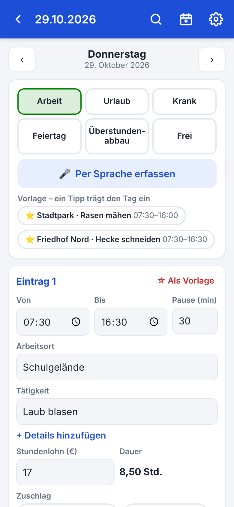
  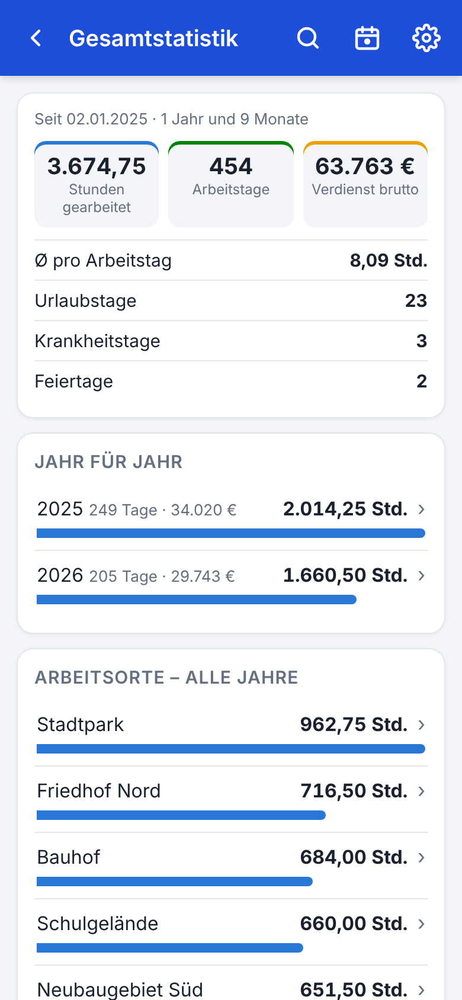
  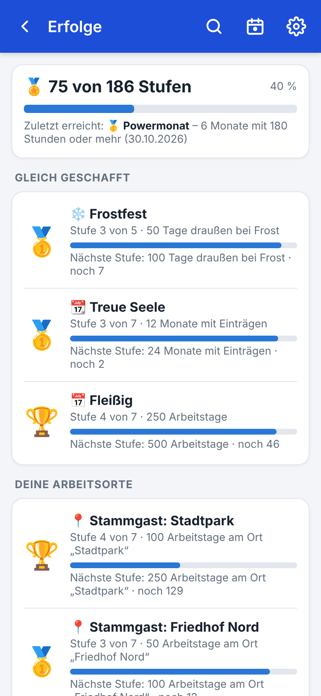

Tag erfassen · Gesamtstatistik · Erfolge

  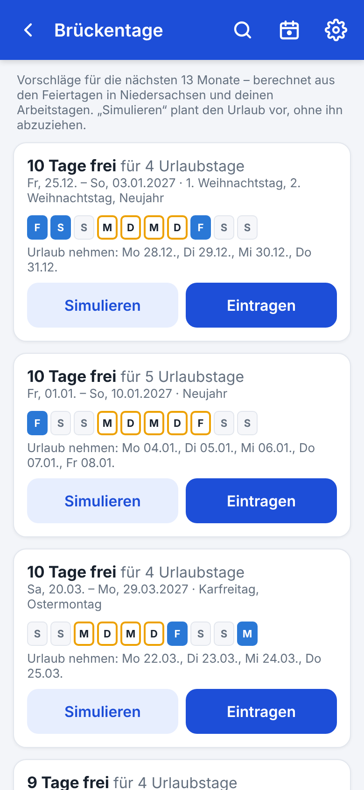
  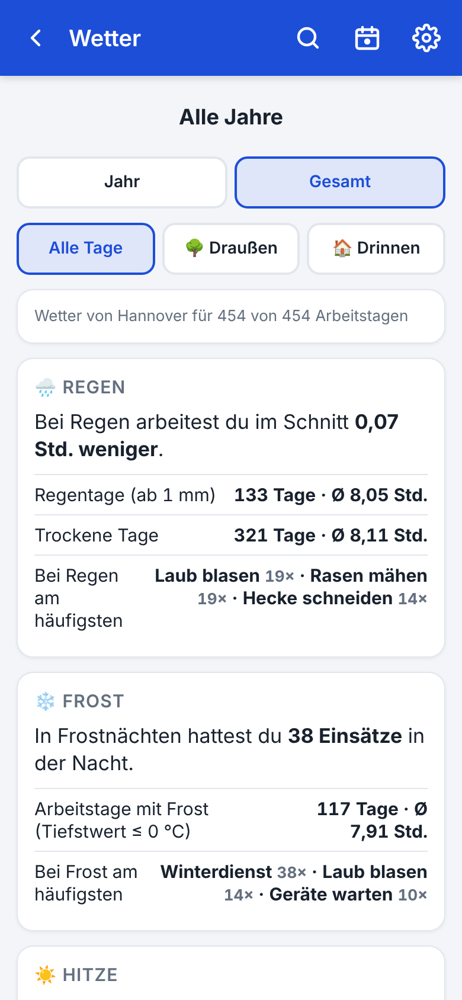
  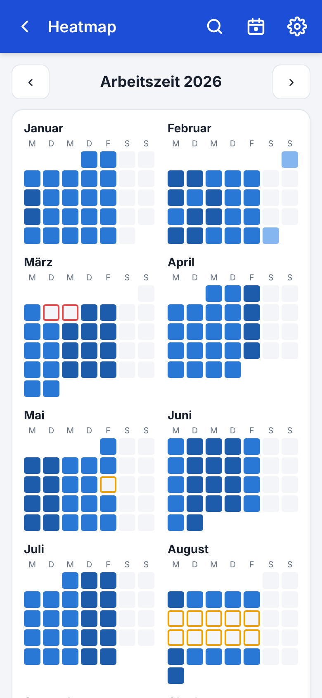

Brückentag-Planer · Wetter-Auswertung · Heatmap

  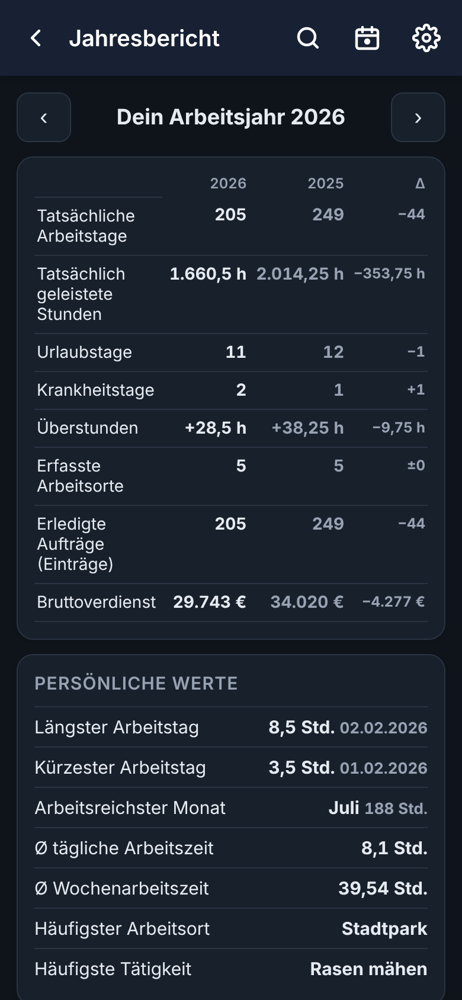
  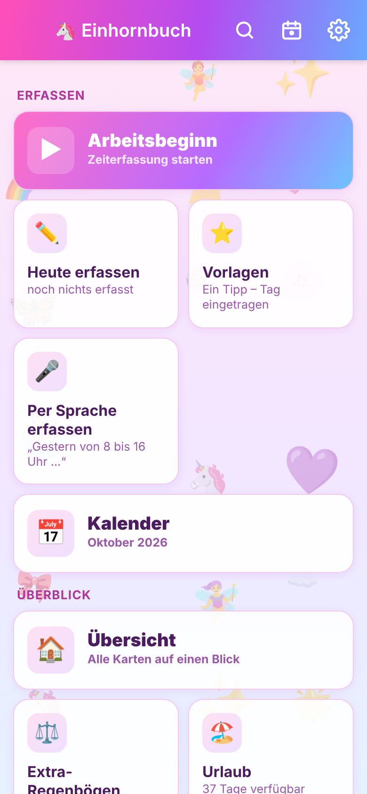
  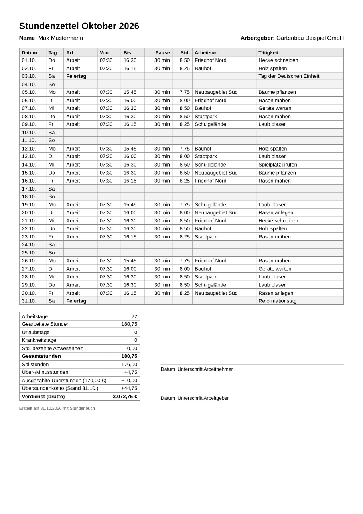

Dunkler Modus · 🦄 Einhorn-Modus · Stundenzettel als PDF

  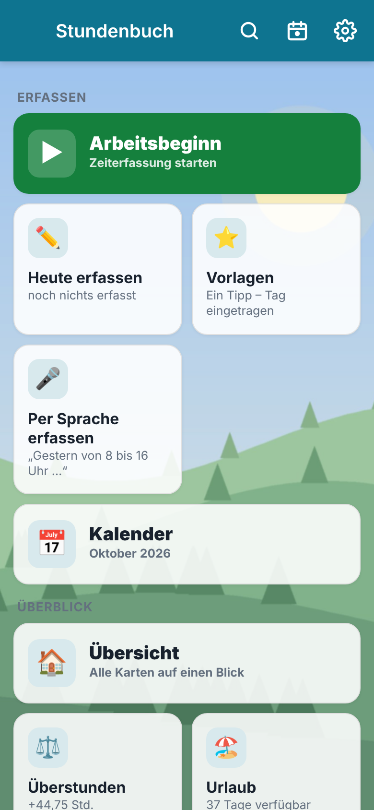
  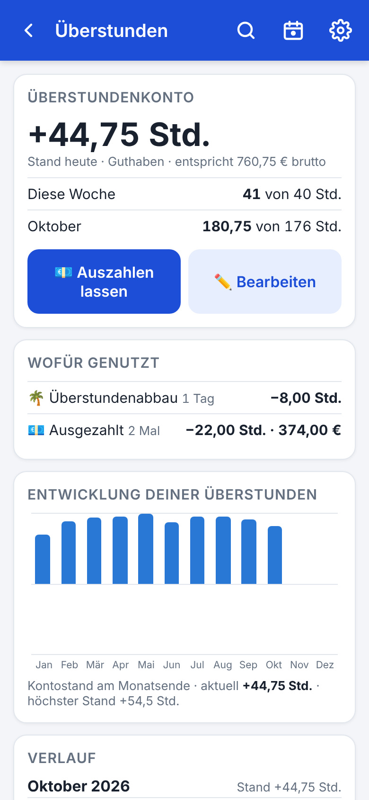
  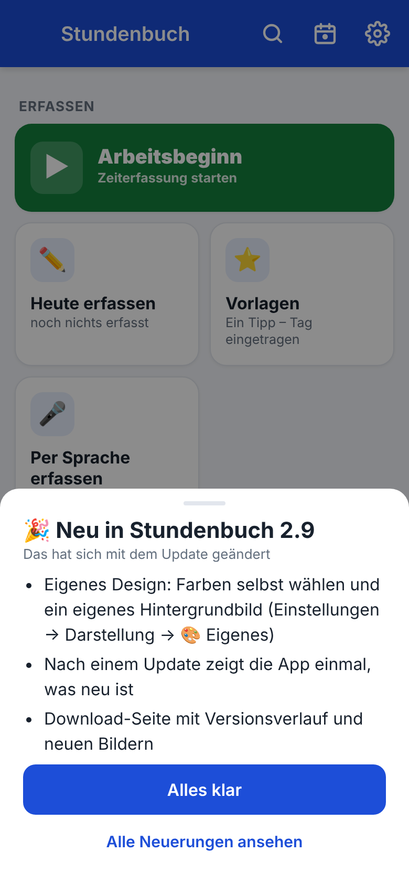

🎨 Eigenes Design · Überstundenkonto mit Verlauf · „Was ist neu?“ nach dem Update

Alle Bilder zeigen ausgedachte Beispieldaten.

---

## Installieren

1. **[Stundenbuch.apk](https://github.com/games-yves-mrichter-droid/stundenbuch-updates/raw/main/Stundenbuch.apk)** auf dem Android-Handy herunterladen.
2. Datei antippen und installieren. Beim ersten Mal fragt Android, ob du Apps aus dieser Quelle installieren möchtest – erlauben.
3. Fertig. **Neue Versionen meldet die App selbst** (Einstellungen → App & Updates) – deine Einträge bleiben dabei erhalten. Nach jedem Update zeigt sie einmal, was neu ist.

Android 7 oder neuer.

## Neu in 2.9

- Eigenes Design: Farben selbst wählen und ein eigenes Hintergrundbild (Einstellungen → Darstellung → 🎨 Eigenes)
- Nach einem Update zeigt die App einmal, was neu ist
- Download-Seite mit Versionsverlauf und neuen Bildern

## Versionsverlauf

<b>Version 2.8</b>

- Überstundenkonto mit Verlauf: Monat für Monat sehen, wie viele Überstunden du erarbeitet und wofür du sie genutzt hast
- Überstunden auszahlen lassen: Stunden und Stundenlohn eintragen – die Summe wird ausgerechnet
- Überstundenkonto bearbeiten: Kontostand festlegen oder Stunden hinzufügen/abziehen
- Auszahlungen und Korrekturen stehen auch auf dem Stundenzettel

<b>Version 2.7.1</b>

- Neues App-Symbol

<b>Version 2.7</b>

- Updates direkt in der App: Einstellungen → App & Updates
- Download-Link mit Freunden teilen

<b>Version 2.6</b>

- Wetter-Auswertung: Regen, Frost und Hitze
- Persönliche Erfolge passend zu deinen Arbeitsorten und Tätigkeiten
- Draußen oder drinnen je Tag und Arbeitsort – mit Symbol im Kalender

<b>Version 2.5</b>

- Gesamtstatistik über alle Jahre
- Aufräumen: gleiche Orte und Tätigkeiten dauerhaft zusammenführen

<b>Version 2.4</b>

- 🦄 Einhorn-Modus

<b>Version 2.3</b>

- Automatische Datensicherung
- Vorlagen: häufige Tage mit einem Tipp eintragen
- Nachtzuschlag nach Uhrzeit, Zuschläge auch als Zeitgutschrift
- Stundenzettel gestalten, auf eine A4-Seite anpassen und als PDF teilen

<b>Version 2.2</b>

- Übernahme aus Stundenrechner Pro
- Orte und Tätigkeiten ohne Rücksicht auf Groß-/Kleinschreibung zusammengefasst
- Alle Tage je Ort und Tätigkeit ansehen

<b>Version 2.1</b>

- Hauptmenü zum Selbstgestalten
- Brückentag-Planer mit Urlaubs-Simulation
- Arbeitszeit-Simulator
- Arbeitszeit-Heatmap

<b>Version 2.0</b>

- Wettertagebuch, Spracheingabe, Fotos und Auslagen
- Widget für den Startbildschirm
- Lohnentwicklung, Jahresbericht als PDF und Suche

